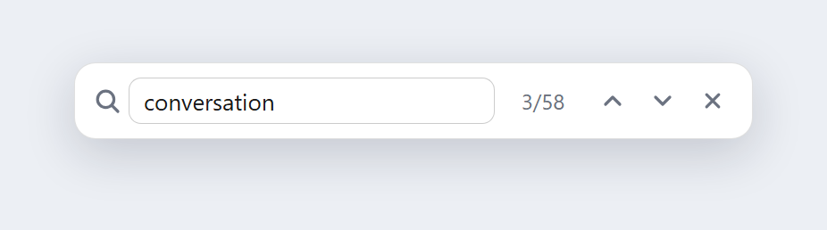
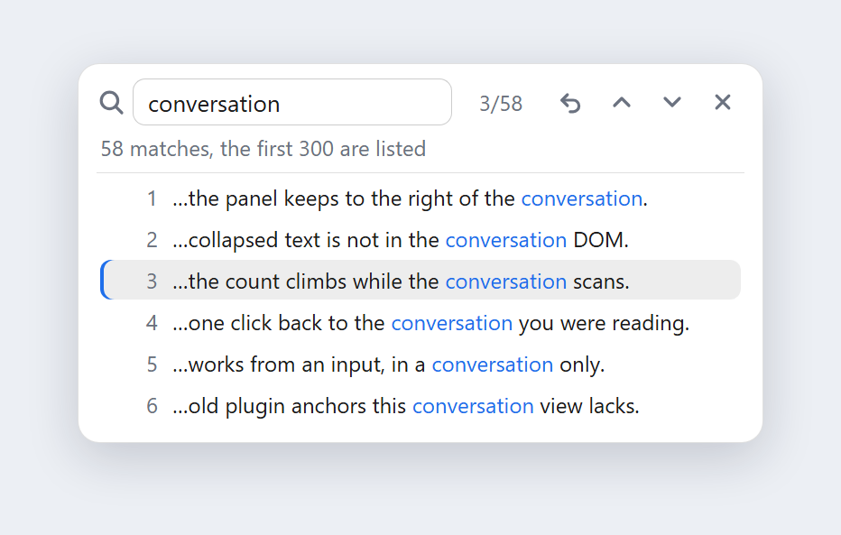

# dsh-chat-search

**Find-in-conversation for DeepSeek Harness.** `Ctrl+F` searches the conversation you are reading: in-text highlights, previous/next, a match list, and a count that climbs while the scan runs — **without opening a single collapsed block or moving your reading position.**

English ｜ [简体中文](README.md)





<sub>Interface previews, rendered with the plugin's own stylesheet; they contain no conversation content.</sub>

## Why another one

Harness has no find-in-conversation of its own, so `Ctrl+F` falls through to the browser and does nothing useful. The plugin in the marketplace does not work either: it locates messages through `data-chat-anchor-key`, `data-chat-node-key` and `data-chat-turn`, and **none of those attributes exist in the 0.2.x conversation view any more** (there is only `data-conversation-region`, `data-conversation-scroll` and `data-conversation-session`). With no anchors, every jump resolves to nothing.

This plugin is written against the current DOM contract, and drops the interruption that search usually brings with it:

| | Browser find | The old plugin | This plugin |
| --- | --- | --- | --- |
| Only inside the conversation (not the composer or the sidebar) | ❌ | ✅ | ✅ |
| Highlights | ❌ | flashes the whole message | ✅ per character |
| Previous / next | ❌ | ✅ | ✅ |
| **Opens no collapsed block, moves nothing** | — | ❌ expands everything | ✅ |
| Count grows while scanning | — | ❌ one blocking pass | ✅ |
| First hit is the one near you | — | ❌ always from the top | ✅ |
| IME composition is not searched | — | ❌ | ✅ |
| Clicking outside keeps the panel | — | ❌ closes on click | ✅ |

## Features

- **`Ctrl+F` anywhere** — including while the caret is in an input (no browser find bar); pressing it again focuses and selects the field.
- **A count that climbs**: the scan is sliced (≈900 nodes / 8ms per frame), so a long conversation stays responsive and the number keeps rising instead of blocking.
- **Real text highlights** via the CSS Custom Highlight API — ranges only, nothing inserted into React's DOM, no reflow.
- **Previous / next** with `Enter` / `Shift+Enter`, wrapping at the ends.
- **The first hit is the one nearest to you**: the current viewport top is the anchor, the nearest at-or-after match wins, and it is scrolled only as far as it must be (not at all when already visible).
- **Match list**: click the counter to open every hit (up to 300), each with its snippet; click a row to jump.
- **Back to where you were**: after a jump, `⟲` returns to the reading position you had when you opened the panel (anchored to an element, so paging in history does not throw it off).
- **Non-invasive**: no collapsed block is opened, the conversation is never mutated; clicking the panel background or the chat area does not close it; `Esc` closes and returns focus to where it was.
- **History paging**: earlier messages are loaded on demand (up to 80 pages / 12s); if it cannot finish, the panel says only the loaded part was searched.
- **Follows the theme**: only `--dsw-alias-*` tokens, so light and dark both work.

### Keys

| Key | Action |
| --- | --- |
| `Ctrl+F` / `Cmd+F` | Open; when already open, focus and select |
| `Enter` / `↓` button | Next match |
| `Shift+Enter` / `↑` button | Previous match |
| `Esc` | Close and restore focus |
| Click `3/58` | Toggle the match list |

## Installation

> DeepSeek Harness desktop, 0.2.x. Refresh the page afterwards — no restart needed.

**A. Through the plugin installer**

Point it at the repository:

```
git+https://github.com/1834395550/dsh-chat-search.git
```

**B. Straight into a profile**

```powershell
git clone https://github.com/1834395550/dsh-chat-search.git
```

Then add one dependency and one bundle entry to the profile's `package.json` (`%USERPROFILE%\.dsh\profiles\<profile>\package.json`):

```jsonc
{
  "dependencies": {
    "dsh-chat-search": "file:D:/path/to/dsh-chat-search"
  },
  "dsh": {
    "profile": {
      "bundles": ["...", "dsh-chat-search"]
    }
  }
}
```

Let Harness install the dependency (it does so on the next start, or run `pnpm install` in that directory) and refresh the page.

**Option C: prebuilt release tarball (what the plugin market installs)**

```
https://github.com/1834395550/dsh-chat-search/releases/download/v1.0.1/dsh-chat-search-1.0.1.tgz
```

Hand it to the plugin installer: no source build, no `allowBuilds` approval.

> The plugin market (`dshmarket`) only lists entries from the curated `awesome-dsh-plugin` registry, so a package in your own repository cannot be searched there. This repo is already arranged to meet that registry's requirements (`dsh.bundle` in `package.json`, `screenshots.json` at the root, raster icons under `assets/`, a prebuilt tarball on the release) — once it is listed, **Plugins → Market** finds it with a `search` query and installs it in one click.

> ⚠️ **Name clash**: the community plugin `helo060228/dsh-chat-search` uses the same package name. Remove that dependency and bundle entry first — npm would otherwise overwrite one with the other, and both bundles would fight over `Ctrl+F` in the same overlay slot.

## How it works

1. **Find the conversation**: `[data-conversation-region="chat"]` is the chat area; `[data-conversation-scroll]` is the scroller. `[data-conversation-region="composer"]` sits *inside* the chat region, so it is pruned entirely — what you are typing is never searched.
2. **Build text blocks**: a hand-written tree walker groups text nodes by their nearest non-inline ancestor into strings, so a phrase still matches when it spans `<code>`, `<span>` or bold text; `script/style/svg/hidden` is skipped.
3. **Slice the scan**: ~900 nodes or 8ms per frame, with results published in batches — that is why the count rises rather than appearing all at once.
4. **Paint**: one `Range` per match into `CSS.highlights` (all matches in one registry, the current match in a second one with higher priority); colours live in the component's own `<style>`.
5. **Navigate**: `elementFromPoint` gives the block at the viewport top, `compareDocumentPosition` picks the first match at or after it, and scrolling corrects each scroll container from the outside in, moving as little as possible.
6. **IME**: `compositionstart/end` + `isComposing` + `keyCode 229`. Nothing is searched and no key is handled while a composition is open; the word is searched once, after it lands.

## Limits (on purpose)

- **Text inside collapsed blocks cannot be found**: tool calls, reasoning and folded output are conditional renders, so their content is not in the DOM at all. Reaching it would mean opening blocks — exactly the thing that throws off your reading position — so the plugin does not. A default-off "include collapsed content" switch is the possible follow-up.
- **3000 matches** counted, 1200 painted, 300 rows listed.
- **Earlier history** is paged in for at most 80 pages / 12s; past that the panel says only the loaded part was searched.
- **Needs the CSS Custom Highlight API** (Chromium 105+; the desktop app has it). Without it navigation still works, just without colour.
- **Bound to the host DOM contract** (`data-conversation-*`). A major Harness layout change needs an update here — the same reason the old plugin stopped working.

## Layout

```
client.js         # everything: walker, scan, highlights, panel (React + CSS)
index.js          # host half, empty (this plugin is client-only)
cordis.patch.yml  # inserts the bundle into a profile
locale/zh.json    # plugin metadata (title, description)
locale/en.json
icon.svg
screenshots/      # the previews used above
```

No build step and no dependencies: `client.js` is one `window.__ModuleLoader__.load({...})` factory that takes React from the host's module table.

## Development

- Edit `client.js` and refresh the page (a `file:` linked plugin needs no reinstall).
- `node --check client.js` for syntax.
- The panel is registered with `ctx.slots.register({ name: 'shell.overlay', id: 'dsh-chat-search', order: 60 }, FindOverlay)`; the overlay layer is click-through, only the panel takes pointer events.

## License

MIT © 1834395550
