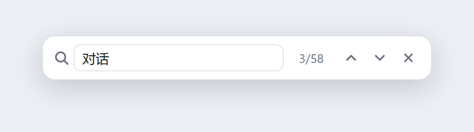
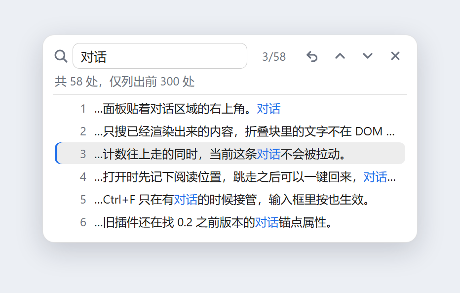

# 对话内查找 · dsh-chat-search

**DeepSeek Harness 的对话内搜索插件。** 按 `Ctrl+F` 就能在当前对话里查找关键词：正文高亮、上一个/下一个、命中位置列表，计数边搜边涨——而且**不展开任何折叠块，不改变你正在看的位置**。

[English](README.en.md) ｜ 简体中文





<sub>图为插件面板的界面预览（用插件自己的样式表渲染），不含任何真实对话内容。</sub>

## 为什么还要一个

Harness 本身没有对话内查找，`Ctrl+F` 交给浏览器后什么也不会发生；插件市场里的同类插件装上却用不了，因为它定位聊天内容靠的是 `data-chat-anchor-key`、`data-chat-node-key`、`data-chat-turn` 这类属性——**这些属性在 0.2.x 的会话视图里已经不存在了**（现在只有 `data-conversation-region`、`data-conversation-scroll`、`data-conversation-session`）。锚点找不到，跳转就永远是空的。

这个插件按现在的 DOM 契约重写，顺手把「搜索时的打扰感」也一起去掉了：

| | 浏览器原生查找 | 老插件 | 本插件 |
| --- | --- | --- | --- |
| 只在对话里搜（不含输入框/侧栏） | ❌ | ✅ | ✅ |
| 正文高亮 | ❌ | 只闪整条消息 | ✅ 按字符高亮 |
| 上一个 / 下一个 | ❌ | ✅ | ✅ |
| **不展开折叠块、不移动阅读位置** | — | ❌ 会展开全部 | ✅ |
| 计数随扫描实时增长 | — | ❌ 一次性阻塞 | ✅ |
| 首个命中就在你附近 | — | ❌ 从对话最顶上开始 | ✅ |
| 中文输入法合成时不误搜 | — | ❌ | ✅ |
| 点击面板外不关闭 | — | ❌ 点就关 | ✅ |

## 功能

- **`Ctrl+F` 随时唤起**——包括光标停在输入框里的时候（不再弹浏览器原生查找栏）；已经打开时再按一次 = 聚焦并全选。
- **边搜边涨的计数**：扫描分片进行（每帧约 900 个节点 / 8ms），长对话也不会把界面卡住，数字一路往上走。
- **正文高亮**：用 CSS Custom Highlight API 画 Range，不往 React 的 DOM 里插 `<mark>`，所以不会触发重排、不会和宿主抢节点。
- **上一个 / 下一个**：`Enter` / `Shift+Enter`，到尽头自动回绕。
- **首个命中 = 离你最近的那处**：以当前视口顶部为锚，从近到远找第一个匹配，只有不可见时才滚动，且只滚到"刚好看得见"。
- **命中位置列表**：点击计数展开全部命中（最多 300 条），每条带片段，命中词标蓝，点哪条跳哪条。
- **回到搜索前的位置**：跳走之后点 `⟲`，一键回到开始搜索时的阅读位置（锚的是元素而不是滚动像素，所以中途加载历史也不会偏）。
- **不打扰**：不展开折叠块、不改动对话内容；点面板空白处、点聊天区都不会关；`Esc` 才关，并且把焦点还给打开前的元素。
- **顺手补历史**：开头会按需加载更早的消息（最多 80 页 / 12 秒），加载不完会在面板里说明"只搜索了已加载的部分"。
- **跟随主题**：只用 `--dsw-alias-*` 主题 token，明暗主题自动适配。

### 快捷键

| 按键 | 作用 |
| --- | --- |
| `Ctrl+F` / `Cmd+F` | 打开搜索；已打开则聚焦并全选 |
| `Enter` / `↓` 按钮 | 下一个命中 |
| `Shift+Enter` / `↑` 按钮 | 上一个命中 |
| `Esc` | 退出搜索，焦点还回原处 |
| 点击 `3/58` | 展开 / 收起命中位置列表 |

## 安装

> 需要 DeepSeek Harness 桌面版（0.2.x）。装完**刷新页面**即可生效，不用重启应用。

**方式 A：插件安装器**

在 Harness 的插件安装入口填仓库地址：

```
git+https://github.com/1834395550/dsh-chat-search.git
```

**方式 B：放进 profile（本地开发也走这条）**

```powershell
git clone https://github.com/1834395550/dsh-chat-search.git
```

然后在 profile 的 `package.json`（`%USERPROFILE%\.dsh\profiles\<profile>\package.json`）里加一条依赖和一条 bundle：

```jsonc
{
  "dependencies": {
    "dsh-chat-search": "file:D:/path/to/dsh-chat-search"
  },
  "dsh": {
    "profile": {
      "bundles": ["...", "dsh-chat-search"]
    }
  }
}
```

再让 Harness 装一次依赖（下次启动会自动装；也可以在该目录执行 `pnpm install`），刷新页面。

> ⚠️ **与同名旧插件冲突**：社区里另一个也叫 `dsh-chat-search` 的包（`helo060228/dsh-chat-search`）用的是同一个包名。装本插件前请先把旧的那条依赖和 bundle 删掉，否则 npm 会直接覆盖，且两个 bundle 会在同一个 overlay 槽里抢 `Ctrl+F`。

## 它怎么工作

1. **找到对话**：`[data-conversation-region="chat"]` 就是聊天区，滚动容器是 `[data-conversation-scroll]`；`[data-conversation-region="composer"]`（输入框那一块在 chat region 里面）整个剪掉，所以搜不到自己正在写的字。
2. **把文本拼成块**：手写一个走树的 walker，把文本节点按"最近的非行内祖先"分组拼成字符串——所以短语即使跨了 `<code>`、`<span>`、加粗，也能整句命中；`script/style/svg/hidden` 一律跳过。
3. **分片扫描**：walker 每帧只走约 900 个节点或 8ms，匹配结果攒够一批再交给界面，计数因此是"涨"出来的而不是等出来的。
4. **高亮**：每个命中造一个 `Range`，丢进 `CSS.highlights`（全部命中一个集合、当前命中另一个集合，优先级更高），配色写在组件内的 `<style>` 里。
5. **定位**：用 `elementFromPoint` 取视口顶部那块节点当锚，`compareDocumentPosition` 找到第一个"在锚之后"的命中；滚动时由外到内逐个滚动容器校正，只做最小位移。
6. **输入法**：`compositionstart/end` + `isComposing` + `keyCode 229` 三重判断，合成期间不搜索、不响应 `Enter`/`Esc`，落字之后才搜一次。

## 限制（都是有意为之）

- **折叠块里的文字搜不到**：Tool 调用、思考过程、被折叠的长输出都是条件渲染，内容根本不在 DOM 里。想要搜到它们只能先点开——而这正好会改变你的阅读位置，与"无痕"冲突，所以不做。需要的话可以后续加一个默认关闭的「包含折叠内容」开关。
- **命中上限 3000**、染色上限 1200、位置列表 300 条（再多也没有意义，读不过来）。
- **更早的历史**最多补 80 页 / 12 秒，超出会显示"只搜索了已加载的部分"。
- **需要 CSS Custom Highlight API**（Chromium 105+，Harness 桌面版满足）；不支持时仍能定位跳转，只是不染色。
- **绑定宿主 DOM 契约**：依赖 `data-conversation-*` 这几个属性。Harness 大版本改了结构就需要更新插件（这也是老插件坏掉的原因）。

## 文件结构

```
client.js         # 全部功能：扫描、高亮、面板（React 组件 + CSS）
index.js          # Host 半，空实现（本插件纯前端）
cordis.patch.yml  # 把 bundle 插进 profile
locale/zh.json    # 插件信息（名称/简介）
locale/en.json
icon.svg
screenshots/      # README 里的界面预览
```

没有构建步骤、没有第三方依赖：`client.js` 是一个 `window.__ModuleLoader__.load({...})` 的工厂函数，React 从宿主模块表里 `require('react')` 拿。

## 开发

- 改 `client.js` 后刷新页面就生效（插件以 `file:` 链接进 profile 时不需要重装）。
- `node --check client.js` 做语法检查。
- 插件通过 `ctx.slots.register({ name: 'shell.overlay', id: 'dsh-chat-search', order: 60 }, FindOverlay)` 挂到全屏浮层槽位，浮层本身 click-through，只有面板自己接收鼠标事件。

## 许可证

MIT © 1834395550
